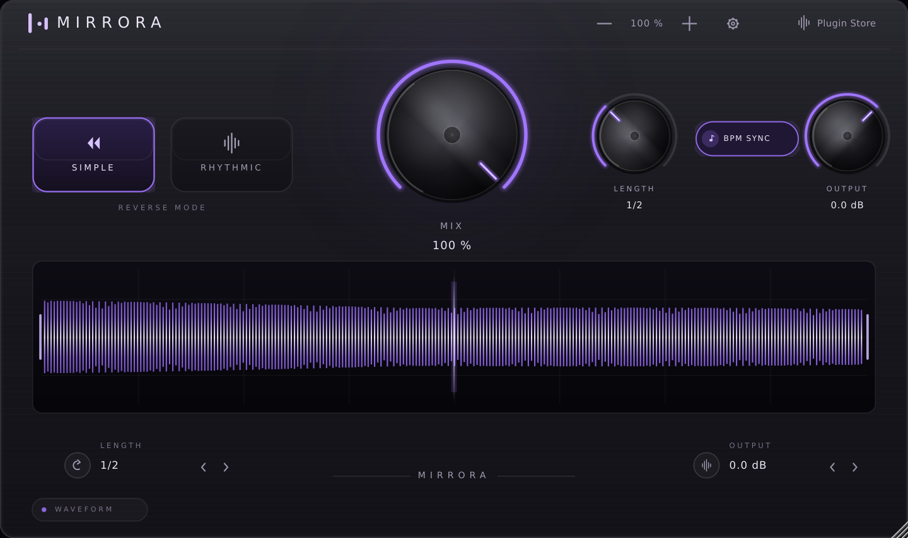

# MIRRORA

Real-time **reverse** audio effect (VST3 + AU) with a dark, brushed-metal interface.



*(the image above is rendered straight from the plug-in editor by CI — see
`tools/preview`)*

MIRRORA keeps recording the incoming signal into a window and, the instant that
window is complete, plays it back **backwards** while the next window is being
recorded. The window is either a fixed length (SIMPLE) or locked to the host
tempo (RHYTHMIC), so reversed tails always land on the beat.

## Download

Compiled binaries are attached to the [latest release](https://github.com/maanikaafi-hub/MIRRORA/releases/latest):

| Platform | File | Formats |
|---|---|---|
| Windows 10/11 x64 | `MIRRORA-Windows-x64-VST3.zip` | VST3 |
| macOS 10.13+ (Intel + Apple Silicon, universal) | `MIRRORA-macOS-VST3.zip`, `MIRRORA-macOS-AU.zip` | VST3, AU |

### Install — Windows
1. Extract `MIRRORA-Windows-x64-VST3.zip`.
2. Copy the `MIRRORA.vst3` folder to `C:\Program Files\Common Files\VST3\`.
3. Rescan plug-ins in your DAW.

### Install — macOS
```bash
# VST3
sudo cp -R MIRRORA.vst3        /Library/Audio/Plug-Ins/VST3/
# AU
sudo cp -R MIRRORA.component   /Library/Audio/Plug-Ins/Components/

# the builds are not notarised — clear the quarantine flag once:
sudo xattr -cr /Library/Audio/Plug-Ins/VST3/MIRRORA.vst3
sudo xattr -cr /Library/Audio/Plug-Ins/Components/MIRRORA.component
```
If Logic/GarageBand does not show the AU, run `killall -9 AudioComponentRegistrar`
or `auval -a` once.

## Controls

| Control | What it does |
|---|---|
| **SIMPLE / RHYTHMIC** | Reverse mode. SIMPLE uses a fixed window with a soft de-click fade; RHYTHMIC snaps the window to the tempo and uses a tight fade so the reversed part punches on the grid. |
| **MIX** | Dry/wet balance (0–100 %). |
| **LENGTH** (knob + bottom stepper) | Window size: `1/4`, `1/2`, `1 Bar`, `2 Bars` in RHYTHMIC mode, `0.25 s` … `2 s` in SIMPLE mode. |
| **BPM SYNC** | Follow the host tempo when the host reports it. |
| **OUTPUT** (knob + bottom stepper) | Output level, −24 … +12 dB. |
| **Waveform** | Live scope of the audio that is being captured for reversal. |
| **− 100 % +** | GUI zoom (70 % … 175 %). The window is also freely resizable. |
| **Gear** | About card. |

Automation parameters: `mode`, `mix`, `length`, `sync`, `output` (plus a hidden
`bpm` fallback that is used when the host does not report a tempo).

## Build from source

Requirements: CMake 3.22+, a C++17 compiler, and JUCE 8.0.8. JUCE is picked up
from `$JUCE_DIR`, from `./JUCE`, `../JUCE`, or downloaded automatically by CMake.

```bash
# Windows x64 — VST3
build_windows_x64.bat

# macOS — universal VST3 + AU
./build_macos.sh

# or manually
cmake -S . -B build -DCMAKE_BUILD_TYPE=Release
cmake --build build --target MIRRORA_VST3 --parallel
```

Output:
* `build/MIRRORA_artefacts/Release/VST3/MIRRORA.vst3`
* `build/MIRRORA_artefacts/Release/AU/MIRRORA.component` (macOS only)

GitHub Actions builds all of the above on every push (`.github/workflows/build.yml`),
and `.github/workflows/gui-preview.yml` renders the editor off-screen and runs the
offline engine self-test (`tools/audiotest`, results in `docs/selftest.log`).

## What was fixed in 1.0.0

The previous prototype did not work as a reverse effect. This version:

* **Engine rewritten.** The old code wrote into one buffer while reading from a
  second one that was never swapped correctly, so the "wet" signal was mostly
  silence/garbage. Capture and playback now ping-pong between two buffers, and
  the read is a fractional (interpolated) reverse ramp.
* **Real reverse, not a delay.** Playback walks the captured window from its
  last sample to its first.
* **No clicks.** Short cosine fades at both window edges (2.5 ms in RHYTHMIC,
  10 ms in SIMPLE) plus smoothed MIX/OUTPUT to remove zipper noise.
* **Tempo lock works.** The window length is recomputed per block from the host
  BPM (with a safe fallback) and applied at the next window boundary.
* **Parameter text is correct.** `100 %`, `1/2`, `0.0 dB` instead of raw floats,
  and every control is a proper automatable parameter with host gestures.
* **Length change is glitch-free** and the buffers are allocated for the worst
  case (8 s window) in `prepareToPlay`, never in `processBlock`.
* **GUI rebuilt** as resolution-independent vector graphics that match the
  artwork exactly (metal knobs, purple value arcs, mode buttons, BPM SYNC pill,
  animated waveform, bottom steppers, header zoom) and scale crisply from 70 %
  to 175 %.
* **Build fixed** for Windows (VST3) and macOS (VST3 + AU, universal); AU is
  only built on Apple platforms.

## Notes / limitations

* The effect needs a full window of audio before the first reversed pass, so at
  100 % mix the first `LENGTH` seconds are silent. That is inherent to reverse.
* Reversal introduces no reported latency, but the wet signal lags the dry
  signal by exactly one window length.
* Maximum window length is 8 seconds.

---

Made by **MaaNi KaaFi** · Plugin Store
